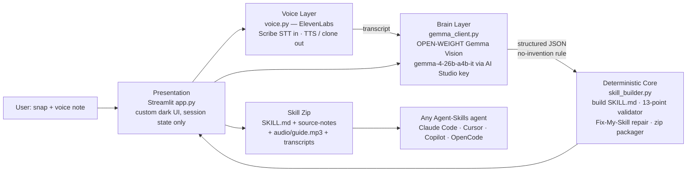

# Snap2Skill — System Design

## Design principles
1. **AI proposes, code disposes.** Gemma and ElevenLabs are replaceable services at the edges. Every trust-critical output — the skill file format, its compliance verdict, the zip layout — is produced by deterministic code that can be unit-tested with no API key (`tests/`).
2. **Fail soft, never fail closed.** No ElevenLabs key → voice features disable, text pipeline completes. No Google key → demo mode completes. A venue Wi-Fi failure cannot kill the demo.
3. **No server-side storage.** All state lives in the browser session (`st.session_state`). Uploaded snaps/audio are processed in memory/temp files for the request only. Keys live in a local `.env` (git-ignored), are never rendered in the UI, and only their *presence* is shown in the status panel.
4. **Honesty is a feature, enforced in prompts + code.** Gemma must flag unclear source content in `unclear_items` instead of inventing steps; the UI surfaces those flags in amber; the human editor can fix them before the validator runs.
5. **One builder, everywhere.** The UI, Fix-My-Skill repair, and Snap2Skill's own shipped skill all go through the same `build_skill_md()` / `validate_skill_md()` — there is no second, weaker code path for generated output.

## Layers & files
| Layer | File | Responsibility | External dependency |
|---|---|---|---|
| Presentation | `app.py`, `.streamlit/config.toml` | 4-tab UI (Create, Walkthrough, Fix, Clone), hero/status design system | Streamlit |
| Voice | `voice.py` | Scribe transcription, Flash/Multilingual TTS, instant voice cloning (consent-gated in UI) | ElevenLabs API (optional) |
| Brain | `gemma_client.py` | Vision extraction (multi-snap ≤5), translation for narration, demo fallback | Gemma via Gemini API (Gemma IDs only) |
| Core | `skill_builder.py` | slugify, SKILL.md builder, 13-point validator, repair, zip with audio | none (pure Python) |
| Data | `samples.py` | Labelled offline sample extractions | none |

## Scaling note (post-hackathon)
The core is UI-independent: `skill_builder` + `gemma_client` + `voice` can be wrapped by a FastAPI service unchanged, with Streamlit swapped for any frontend. Model IDs and voice IDs are environment-configured, so providers can be swapped (e.g. Gemma via Ollama locally) without touching the core.
