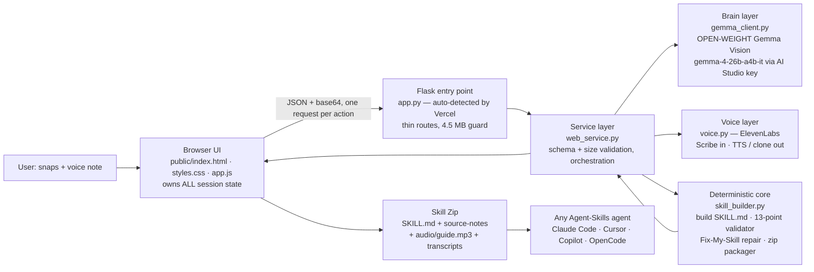

# Snap2Skill — System Design

Production runs on **Vercel**. The design rule that shaped everything:
*Vercel serves static files from a CDN and runs stateless Functions per
request — so the browser owns the session and every operation is one
complete HTTP request.* (Full deployment guide: `VERCEL_DEPLOYMENT.md`.)

## Design principles
1. **AI proposes, code disposes.** Gemma and ElevenLabs are replaceable services at the edges. Every trust-critical output — the skill file format, its compliance verdict, the zip layout — is produced by deterministic code that can be unit-tested with no API key (`tests/`).
2. **Stateless by platform design.** No server session, no disk writes, no in-memory user state. The browser sends the full extraction with each build request, so cold starts, scale-out and redeploys cannot corrupt a session.
3. **Fail soft, never fail closed.** No ElevenLabs key → voice features disable, text pipeline completes. No Google key → labelled demo mode completes. A provider outage cannot kill the demo.
4. **Honesty is a feature, enforced in prompts + code.** Gemma must flag unclear source content in `unclear_items` instead of inventing steps; the UI surfaces those flags in amber; the human editor can fix them before the validator runs.
5. **One builder, everywhere.** The Vercel UI, Fix-My-Skill repair, the legacy Streamlit UI, and Snap2Skill's own shipped skill all go through the same `build_skill_md()` / `validate_skill_md()` — there is no second, weaker code path for generated output.
6. **Respect the platform's physics.** Vercel's 4.5 MB payload ceiling is enforced three times: the browser downscales images before upload, Flask caps request size, and `web_service.py` re-validates every decoded file. Function duration is set to 300s in `vercel.json` for slow model calls.

## Layers & files
| Layer | File(s) | Responsibility | External dependency |
|---|---|---|---|
| Presentation | `public/index.html`, `public/styles.css`, `public/app.js` | Responsive studio UI (Create, Walkthrough, Fix, Clone), browser-owned state, image downscaling, device-voice fallback | none (static CDN) |
| HTTP | `app.py` | Flask routes for the UI and the 8-endpoint JSON API; serves only `public/` as static | Flask |
| Service | `web_service.py` | Payload cleaning, base64 decode + size limits, orchestration, JSON-safe results | none |
| Brain | `gemma_client.py` | Vision extraction (multi-snap ≤5, in-memory image parts), translation for narration, demo fallback | Gemma via Gemini API (Gemma IDs only) |
| Voice | `voice.py` | Scribe transcription, Flash/Multilingual TTS, instant voice cloning (consent enforced again server-side) | ElevenLabs API (optional) |
| Core | `skill_builder.py` | slugify, SKILL.md builder, 13-point validator, repair, zip with audio | none (pure Python) |
| Data | `samples.py` | Labelled offline sample extractions | none |
| Legacy UI | `streamlit_app.py` | Original local Streamlit interface; not used by Vercel (see `.vercelignore`) | Streamlit (separate requirements file) |

## API summary
`GET /api/bootstrap` (status + samples) · `POST /api/extract` · `POST /api/build` ·
`POST /api/validate` · `POST /api/repair` · `POST /api/narrate` · `POST /api/speak` ·
`POST /api/clone`. Details and limits: `VERCEL_DEPLOYMENT.md`.

## Scaling note
The core is UI- and platform-independent: `skill_builder` + `gemma_client` +
`voice` are called unchanged by the Flask API, the Streamlit app, and the
test-suite. Model IDs and voice IDs are environment-configured, so providers
can be swapped (e.g. Gemma via Ollama locally) without touching the core.
