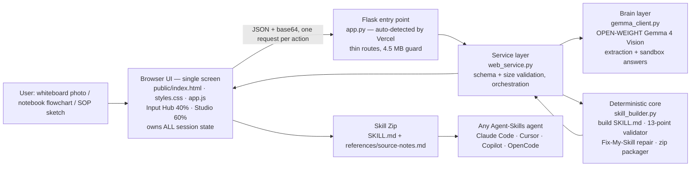

# Snap2Skill — System Design

Production runs on **Vercel**. One product, one workflow:
*snap → Gemma extracts → deterministic code compiles a compliant SKILL.md →
the user tests it in a Live Sandbox.* (Deployment guide: `VERCEL_DEPLOYMENT.md`.)

## Design principles
1. **AI proposes, code disposes.** Gemma is the only model, at the edge. Every trust-critical output — the skill file format, its compliance verdict, the zip layout — is produced by deterministic code that can be unit-tested with no API key (`tests/`).
2. **Stateless by platform design.** No server session, no disk writes, no in-memory user state. The browser sends the full extraction with each build request, so cold starts, scale-out and redeploys cannot corrupt a session.
3. **Fail soft, never fail closed.** No Google key → labelled demo mode completes (sample + pasted-text extraction, deterministic sandbox walkthrough). A provider outage cannot kill the demo.
4. **Honesty is a feature, enforced in prompts + code.** Gemma must flag unclear source content in `unclear_items` instead of inventing steps; the flowchart surfaces those flags; the sandbox prompt forbids the answering agent from using knowledge outside the skill.
5. **One builder, everywhere.** The studio UI, the Fix-My-Skill repair endpoints, and Snap2Skill's own shipped skill all go through the same `build_skill_md()` / `validate_skill_md()` — there is no second, weaker code path for generated output.
6. **Respect the platform's physics.** Vercel's 4.5 MB payload ceiling is enforced three times: the browser downscales images before upload, Flask caps request size, and `web_service.py` re-validates every decoded file. Function duration is set to 300s in `vercel.json` for slow model calls.

## Layers & files
| Layer | File(s) | Responsibility | External dependency |
|---|---|---|---|
| Presentation | `public/index.html`, `public/styles.css`, `public/app.js` | Single-screen studio: Input Hub (dropzone, sample, compile state machine) + Studio tabs (Visual Flowchart, SKILL.md Spec, Live Sandbox). Strict palette: zinc-950/900/800 + indigo-500 + white/zinc-400. Browser-owned state, image downscaling | none (static CDN) |
| HTTP | `app.py` | Flask routes for the UI and the JSON API; serves only `public/` as static | Flask |
| Service | `web_service.py` | Payload cleaning, base64 decode + size limits, orchestration, JSON-safe results | none |
| Brain | `gemma_client.py` | Vision extraction (multi-snap ≤5, in-memory image parts), sandbox answers as the skill, demo fallbacks | Gemma via Gemini API (Gemma IDs only) |
| Core | `skill_builder.py` | slugify, SKILL.md builder, 13-point validator, repair, zip | none (pure Python) |
| Data | `samples.py` | Labelled offline sample extractions | none |

## API summary
`GET /api/bootstrap` (status + samples) · `POST /api/extract` · `POST /api/build` ·
`POST /api/validate` · `POST /api/repair` · `POST /api/sandbox`.
Details and limits: `VERCEL_DEPLOYMENT.md`.

## Scaling note
The core is UI- and platform-independent: `skill_builder` + `gemma_client` are
called unchanged by the Flask API and the test-suite. Model IDs are
environment-configured, so Gemma can be swapped (e.g. via Ollama locally)
without touching the core.
